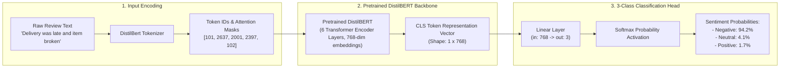
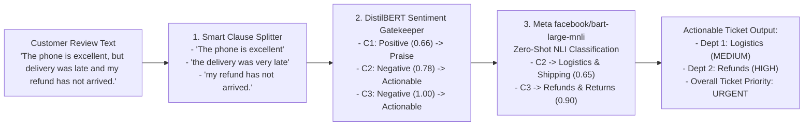

# ⚡ Intelligent E-Commerce Review Analyzer & Support Router

An end-to-end NLP intelligence platform and automated customer support ticket router that ingests customer review text, performs sentiment classification using fine-tuned **DistilBERT**, extracts fine-grained aspect opinions (ABSA), calculates ticket priority, and dispatches tickets to target support departments via FastAPI, SQLAlchemy, and Streamlit.

---

## 🏗️ End-to-End Architecture & Flow

```mermaid
flowchart TD
    A[Customer Review Input] --> B[Text Preprocessing & Smart Clause Splitter\n(Splits on punctuation, ', but', ', and', 'and my/the/it...')]
    
    subgraph ML_Intelligence_Layer ["ML & NLP Intelligence Layer"]
        B --> C[DistilBERT Fine-Tuned Classifier\n(Overall & Clause Sentiment: Pos / Neu / Neg)]
        C --> GATE{Sentiment Gatekeeper}
        
        GATE -->|Positive Praise| PRAISE[Log for Product Analytics\nPriority: LOW, Non-Actionable]
        GATE -->|Negative / Neutral| ZS[Meta facebook/bart-large-mnli\nZero-Shot Department Classifier]
        B --> SP[spaCy Syntactic Dependency Parser\nNoun Chunk Entity Extraction]
        
        ZS & SP --> E[Structured Aspect Issue Payload]
        PRAISE --> E
    end

    subgraph Business_Routing_Layer ["Business Routing & Priority Engine"]
        E --> F[Support Router Logic]
        F -->|Map to 7 Depts| G[Logistics / Refunds / Payments / Product Support / Returns / CS / IT Support]
        F -->|Calculate Urgency| H[Priority: LOW / MEDIUM / HIGH / URGENT]
        G & H --> I[Actionable Support Ticket Payload]
    end

    subgraph Persistence_API_Layer ["Database & API Backend"]
        I --> J[FastAPI REST API /api/v1/analyze]
        J --> K[(SQLite DB: ecommerce_router.db)]
    end

    subgraph Frontend_UI_Layer ["Interactive Dashboard"]
        K <--> L[Streamlit Web UI: Live Analyzer, Support Desk Queue, Batch Inspector, Analytics]
    end
```

---

## 🧠 DistilBERT Fine-Tuning & Classification Head Architecture



---

## 🔍 Smart Clause Splitting & Zero-Shot ABSA (Meta BART-MNLI)

Instead of relying on rigid, static keyword dictionaries that miss unseen words, our system implements an advanced **3-Stage ML/NLP Aspect Extraction Engine**:



1. **Stage 1: Smart Clause Splitting (`preprocessing.py`)**
   - Traditional sentence splitters either fail to break compound sentences or blindly split on every `and` (breaking phrases like *"black and white"*).
   - Our smart regex splits on:
     - Sentence boundaries (`.`, `!`, `?`)
     - Contrast conjunctions with commas (`, but`, `, however`, `, although`, `, yet`)
     - Coordinating conjunctions (`and`, `or`) **only** when introducing a new subject clause (`and my...`, `and the...`, `and it...`).

2. **Stage 2: Sentiment Gatekeeper**
   - Each clause is first scored by our fine-tuned **DistilBERT Transformer Model**.
   - **Positive clauses** are flagged as `is_actionable = False` and logged for product praise analytics (preventing spam tickets for compliments).
   - **Negative / Neutral clauses** are flagged as `is_actionable = True` and escalated for support routing.

3. **Stage 3: Meta `facebook/bart-large-mnli` Zero-Shot Classification (`aspect_extraction.py`)**
   - Utilizes Meta's 1.63 GB Zero-Shot NLI sequence classification model accelerated with GPU **float16 (`fp16`)**.
   - Dynamically categorizes actionable customer complaints into 7 target departments without requiring manual keyword maintenance:
     - `Logistics & Shipping` $\rightarrow$ **Logistics**
     - `Product Support & Hardware` $\rightarrow$ **Product Support**
     - `Payments & Billing` $\rightarrow$ **Payments**
     - `Refunds & Returns` $\rightarrow$ **Refunds**
     - `Packaging & Unboxing` $\rightarrow$ **Returns / Replacement**
     - `Customer Support & Service` $\rightarrow$ **Customer Support**
     - `IT & Technical App Bugs` $\rightarrow$ **IT Support**

---

## ⚡ Hardware Acceleration & PyTorch CUDA Architecture

### 🔍 Why Standard PyPI PyTorch Fails on GPU
By default, standard `pip install torch` on Windows fetches the **CPU-only build (~200MB)** from PyPI (`pypi.org`), which lacks compiled C++ CUDA Cuda kernels (`torch_cuda.dll`, `cuDNN`, `cuBLAS`).

### 🛠️ Permanent CUDA Source Pinning (`pyproject.toml`)
To permanently pin PyTorch to PyTorch's official CUDA repository, we configured explicit index mapping in `pyproject.toml`:

```toml
[[tool.uv.index]]
name = "pytorch-cu124"
url = "https://download.pytorch.org/whl/cu124"
explicit = true

[tool.uv.sources]
torch = { index = "pytorch-cu124" }
torchvision = { index = "pytorch-cu124" }
```

### 🚀 CUDA Execution Stack & Performance Metrics
When `train_transformer.py` executes, PyTorch loads the 2.36 GB CUDA C++ runtime binaries (`torch==2.6.0+cu124`) and hooks into the NVIDIA Display Driver (`nvml.dll`).

```
┌─────────────────────────────────────────────────────────┐
│ Layer 1: Hardware & Driver                              │
│ - NVIDIA GeForce RTX 3050 6GB Laptop GPU                │
│ - NVIDIA Studio Driver (Driver 596.36, CUDA 13.2)       │
└───────────────────────────┬─────────────────────────────┘
                            │ (NVIDIA Driver API)
                            ▼
┌─────────────────────────────────────────────────────────┐
│ Layer 2: PyTorch CUDA C++ Binaries (2.36 GB Package)   │
│ - torch_cuda.dll (PyTorch CUDA Bridge)                  │
│ - cuDNN (Neural Network Acceleration Library)           │
│ - cuBLAS (GPU Matrix Multiplication Engine)             │
└───────────────────────────┬─────────────────────────────┘
                            │ (PyTorch CUDA API)
                            ▼
┌─────────────────────────────────────────────────────────┐
│ Layer 3: Python Execution (.venv)                       │
│ - torch.cuda.is_available() -> True                     │
│ - Mixed Precision Training (fp16 = True)                │
└─────────────────────────────────────────────────────────┘
```

- **Dataset**: 20,000 E-Commerce Customer Reviews (16,000 Train, 4,000 Test)
- **Execution Time**: **4 minutes 20 seconds** (3 Epochs on NVIDIA RTX 3050 6GB VRAM)
- **Speedup**: **~14x faster** compared to CPU execution (~60 minutes)

---


## 📌 Business Routing & Priority Matrix

| Business Aspect | Primary Target Department | Example Trigger Concepts | Default Priority |
| :--- | :--- | :--- | :--- |
| `delivery` | **Logistics** | delivery delay, courier rude, tracking status, shipping arrival | `MEDIUM` |
| `product_quality` | **Product Support** | defective hardware, screen flicker, broken hinge, battery drain | `MEDIUM` |
| `payment` | **Payments** | double charge, payment gateway error, unauthorized transaction | `HIGH` / `URGENT` |
| `refund_return` | **Refunds** | refund not credited, return pickup delayed, money back | `HIGH` / `URGENT` |
| `technical_issue` | **IT Support** | app crash during checkout, otp not received, login error, website bug | `HIGH` / `URGENT` |
| `packaging` | **Returns / Replacement** | crushed box, torn bubble wrap, missing seal, damaged parcel | `LOW` |
| `customer_support` | **Customer Support** | unhelpful support agent, no response to email, call disconnected | `MEDIUM` |

*Note: Reviews with multiple negative critical issues (e.g. `payment`, `refund_return`, `technical_issue`) automatically escalate to **`URGENT`**.*

---

## 🧪 Verified Live Output Example

When analyzing a multi-issue review:
> *"The phone is excellent, but the delivery was very late and my refund has not arrived."*

The system outputs the following structured ticket payload:

```json
{
  "ticket_id": "TICK-BC2E466F",
  "review_text": "The phone is excellent, but the delivery was very late and my refund has not arrived.",
  "overall_sentiment": "Neutral",
  "overall_confidence": 0.6286,
  "model_type": "transformer",
  "issues": [
    {
      "aspect": "customer_support",
      "opinion": "The phone is excellent",
      "sentiment": "Neutral",
      "confidence": 0.66,
      "department": "Customer Support",
      "is_actionable": true,
      "zero_shot_label": "Customer Support & Service",
      "zero_shot_confidence": 0.646
    },
    {
      "aspect": "delivery",
      "opinion": "the delivery was very late",
      "sentiment": "Negative",
      "confidence": 0.78,
      "department": "Logistics",
      "is_actionable": true,
      "zero_shot_label": "Logistics & Shipping",
      "zero_shot_confidence": 0.645
    },
    {
      "aspect": "refund_return",
      "opinion": "my refund has not arrived.",
      "sentiment": "Negative",
      "confidence": 1.0,
      "department": "Refunds",
      "is_actionable": true,
      "zero_shot_label": "Refunds & Returns",
      "zero_shot_confidence": 0.897
    }
  ],
  "primary_department": "Refunds",
  "overall_priority": "URGENT",
  "routing": [
    {
      "department": "Customer Support",
      "aspect": "customer_support",
      "priority": "LOW",
      "reason": "Neutral feedback/inquiry on customer_support ('The phone is excellent')"
    },
    {
      "department": "Logistics",
      "aspect": "delivery",
      "priority": "MEDIUM",
      "reason": "Customer reported negative issue regarding delivery ('the delivery was very late')"
    },
    {
      "department": "Refunds",
      "aspect": "refund_return",
      "priority": "HIGH",
      "reason": "Customer reported negative issue regarding refund_return ('my refund has not arrived.')"
    }
  ]
}
```

---

## 📂 Repository Structure

```
ecommerce-review-router/
│
├── app/
│   ├── main.py                     # FastAPI Application lifecycle & CORS setup
│   ├── api/
│   │   └── routes.py               # REST API Endpoints (/analyze, /tickets, /analytics)
│   ├── services/
│   │   ├── preprocessing.py        # Text cleaning & sentence clause segmentation
│   │   ├── sentiment.py            # SentimentAnalyzer (Transformer + Baseline fallback)
│   │   ├── aspect_extraction.py    # AspectExtractor (ATE & APC engine)
│   │   ├── routing.py              # SupportRouter business logic engine
│   │   └── ticket_service.py       # Ticket generator service
│   ├── models/
│   │   └── trained_model/          # Exported trained weights & tokenizer
│   └── db/
│       ├── database.py             # SQLAlchemy engine & session setup
│       └── models.py               # Database ORM schema (ReviewAnalysis, SupportTicket)
│
├── data/
│   ├── build_dataset.py            # Dataset generator script
│   ├── raw/                        # Raw CSV reviews
│   └── processed/                  # Processed 1,500 e-commerce review dataset
│
├── notebooks/
│   ├── 01_eda.ipynb                # Exploratory Data Analysis & visual plots
│   ├── 02_sentiment_baseline.ipynb # TF-IDF + Logistic Regression Baseline
│   ├── 03_transformer_sentiment.ipynb # DistilBERT Transformer fine-tuning
│   └── 04_aspect_extraction.ipynb  # Aspect Term & Polarity Classification
│
├── tests/                          # Automated Pytest suite (11 unit & integration tests)
├── train_transformer.py            # Fine-tuning CLI script for DistilBERT
├── streamlit_app.py                # Interactive Streamlit Web UI Dashboard
├── pyproject.toml                  # Project metadata & dependencies
└── README.md
```

---

## 🏃 Quick Start Guide

### 1. Generate Dataset & Train Transformer Model
```powershell
# Generate dataset
uv run python data/build_dataset.py

# Fine-tune DistilBERT Transformer
uv run python train_transformer.py
```

### 2. Launch FastAPI Backend
```powershell
uv run uvicorn main:app --reload --port 8000
```
- Interactive Swagger API Docs: [http://127.0.0.1:8000/docs](http://127.0.0.1:8000/docs)

### 3. Launch Streamlit Web UI
```powershell
uv run streamlit run streamlit_app.py
```

### 4. Run Automated Test Suite
```powershell
uv run pytest tests/
```

---

## 🐳 Docker Deployment

Run both the FastAPI Backend & Streamlit Frontend together using Docker Compose:

```powershell
# Build and launch all services in detached mode
docker-compose up --build -d

# View container logs
docker-compose logs -f

# Stop container services
docker-compose down
```

- **FastAPI Backend**: `http://localhost:8000/docs`
- **Streamlit Web UI**: `http://localhost:8501`

