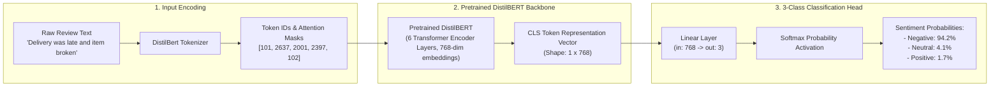
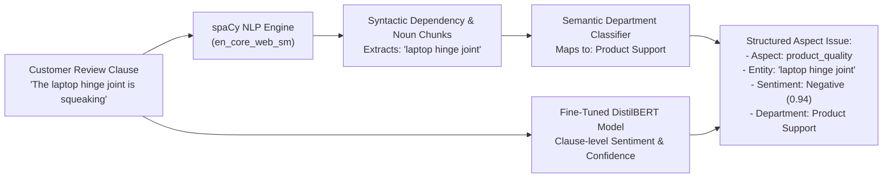

# ⚡ Intelligent E-Commerce Review Analyzer & Support Router

An end-to-end NLP intelligence platform and automated customer support ticket router that ingests customer review text, performs sentiment classification using fine-tuned **DistilBERT**, extracts fine-grained aspect opinions (ABSA), calculates ticket priority, and dispatches tickets to target support departments via FastAPI, SQLAlchemy, and Streamlit.

---

## 🏗️ End-to-End Architecture & Flow

```mermaid
flowchart TD
    A[Customer Review Input] --> B[Text Preprocessing & Sentence Clause Splitter]
    
    subgraph ML_Intelligence_Layer ["ML & NLP Intelligence Layer"]
        B --> C[DistilBERT Fine-Tuned Sentiment Classifier\n(Overall Sentiment: Pos / Neu / Neg)]
        B --> D[spaCy NER & Syntactic Dependency Parser\n(Dynamic Aspect Term Extraction - ATE)]
        D --> D2[Semantic Department & DistilBERT Polarity\n(Aspect Polarity Classification - APC)]
        
        C -->|Overall Sentiment & Confidence| E[Intelligence Payload]
        D2 -->|Dynamic Aspect Entities & Sentiments| E
    end

    subgraph Business_Routing_Layer ["Business Routing & Priority Engine"]
        E --> F[Support Router Logic]
        F -->|Map Aspects to Depts| G[Logistics / Refunds / Payments / Product Support / Returns / CS]
        F -->|Calculate Urgency| H[Priority: LOW / MEDIUM / HIGH / URGENT]
        G & H --> I[Actionable Support Ticket Payload]
    end

    subgraph Persistence_API_Layer ["Database & API Backend"]
        I --> J[FastAPI REST API /api/v1/analyze]
        J --> K[(SQLite DB: ecommerce_router.db)]
    end

    subgraph Frontend_UI_Layer ["Interactive Dashboard"]
        K <--> L[Streamlit Web UI: Live Analyzer, Support Desk Queue, Batch Inspector, Analytics]
    end
```

---

## 🧠 DistilBERT Fine-Tuning & Classification Head Architecture



---

## 🔍 Dynamic Aspect-Based Sentiment Analysis (ABSA) via spaCy NER

Instead of relying on rigid, static keyword dictionaries that miss unseen words, our system implements an advanced **2-Stage ML/NLP Aspect Extraction Engine**:



1. **Stage 1: Dynamic Aspect Term Extraction (ATE)**
   - Utilizes `spaCy` syntactic dependency parsing (`doc.noun_chunks`) to extract real-world product & service noun entities (e.g. *"battery life"*, *"courier driver"*, *"hinge joint"*, *"customer support agent"*, *"package wrapping"*).
   - Dynamically captures novel terms and customer phrasing without requiring manual dictionary maintenance.

2. **Stage 2: Aspect Polarity Classification (APC)**
   - Each extracted aspect clause is passed directly into our fine-tuned **DistilBERT Transformer Model (`SentimentAnalyzer`)**.
   - Generates exact sentiment (`Positive`, `Negative`, `Neutral`) with calibrated probability confidence scores.

---

## ⚡ Hardware Acceleration & PyTorch CUDA Architecture

### 🔍 Why Standard PyPI PyTorch Fails on GPU
By default, standard `pip install torch` on Windows fetches the **CPU-only build (~200MB)** from PyPI (`pypi.org`), which lacks compiled C++ CUDA Cuda kernels (`torch_cuda.dll`, `cuDNN`, `cuBLAS`).

### 🛠️ Permanent CUDA Source Pinning (`pyproject.toml`)
To permanently pin PyTorch to PyTorch's official CUDA repository, we configured explicit index mapping in `pyproject.toml`:

```toml
[[tool.uv.index]]
name = "pytorch-cu124"
url = "https://download.pytorch.org/whl/cu124"
explicit = true

[tool.uv.sources]
torch = { index = "pytorch-cu124" }
torchvision = { index = "pytorch-cu124" }
```

### 🚀 CUDA Execution Stack & Performance Metrics
When `train_transformer.py` executes, PyTorch loads the 2.36 GB CUDA C++ runtime binaries (`torch==2.6.0+cu124`) and hooks into the NVIDIA Display Driver (`nvml.dll`).

```
┌─────────────────────────────────────────────────────────┐
│ Layer 1: Hardware & Driver                              │
│ - NVIDIA GeForce RTX 3050 6GB Laptop GPU                │
│ - NVIDIA Studio Driver (Driver 596.36, CUDA 13.2)       │
└───────────────────────────┬─────────────────────────────┘
                            │ (NVIDIA Driver API)
                            ▼
┌─────────────────────────────────────────────────────────┐
│ Layer 2: PyTorch CUDA C++ Binaries (2.36 GB Package)   │
│ - torch_cuda.dll (PyTorch CUDA Bridge)                  │
│ - cuDNN (Neural Network Acceleration Library)           │
│ - cuBLAS (GPU Matrix Multiplication Engine)             │
└───────────────────────────┬─────────────────────────────┘
                            │ (PyTorch CUDA API)
                            ▼
┌─────────────────────────────────────────────────────────┐
│ Layer 3: Python Execution (.venv)                       │
│ - torch.cuda.is_available() -> True                     │
│ - Mixed Precision Training (fp16 = True)                │
└─────────────────────────────────────────────────────────┘
```

- **Dataset**: 20,000 E-Commerce Customer Reviews (16,000 Train, 4,000 Test)
- **Execution Time**: **4 minutes 20 seconds** (3 Epochs on NVIDIA RTX 3050 6GB VRAM)
- **Speedup**: **~14x faster** compared to CPU execution (~60 minutes)

---


## 📌 Business Routing & Priority Matrix

| Business Aspect | Primary Target Department | Example Keywords | Default Priority |
| :--- | :--- | :--- | :--- |
| `delivery` | **Logistics** | delivery, shipping, courier, delayed, late, tracking | `MEDIUM` |
| `product_quality` | **Product Support** | quality, broken, screen, defective, material, build | `MEDIUM` |
| `payment` | **Payments** | payment, charged twice, fee, gateway, transaction | `HIGH` / `URGENT` |
| `refund_return` | **Refunds** | refund, return, money back, pickup, reimbursement | `HIGH` / `URGENT` |
| `packaging` | **Returns / Replacement** | packaging, box, envelope, bubble wrap, torn | `LOW` |
| `customer_support` | **Customer Support** | support, representative, agent, email, response | `MEDIUM` |

*Note: Reviews with multiple negative critical issues (e.g. Payment failed + Refund pending) are automatically escalated to **`URGENT`**.*

---

## 📂 Repository Structure

```
ecommerce-review-router/
│
├── app/
│   ├── main.py                     # FastAPI Application lifecycle & CORS setup
│   ├── api/
│   │   └── routes.py               # REST API Endpoints (/analyze, /tickets, /analytics)
│   ├── services/
│   │   ├── preprocessing.py        # Text cleaning & sentence clause segmentation
│   │   ├── sentiment.py            # SentimentAnalyzer (Transformer + Baseline fallback)
│   │   ├── aspect_extraction.py    # AspectExtractor (ATE & APC engine)
│   │   ├── routing.py              # SupportRouter business logic engine
│   │   └── ticket_service.py       # Ticket generator service
│   ├── models/
│   │   └── trained_model/          # Exported trained weights & tokenizer
│   └── db/
│       ├── database.py             # SQLAlchemy engine & session setup
│       └── models.py               # Database ORM schema (ReviewAnalysis, SupportTicket)
│
├── data/
│   ├── build_dataset.py            # Dataset generator script
│   ├── raw/                        # Raw CSV reviews
│   └── processed/                  # Processed 1,500 e-commerce review dataset
│
├── notebooks/
│   ├── 01_eda.ipynb                # Exploratory Data Analysis & visual plots
│   ├── 02_sentiment_baseline.ipynb # TF-IDF + Logistic Regression Baseline
│   ├── 03_transformer_sentiment.ipynb # DistilBERT Transformer fine-tuning
│   └── 04_aspect_extraction.ipynb  # Aspect Term & Polarity Classification
│
├── tests/                          # Automated Pytest suite (11 unit & integration tests)
├── train_transformer.py            # Fine-tuning CLI script for DistilBERT
├── streamlit_app.py                # Interactive Streamlit Web UI Dashboard
├── pyproject.toml                  # Project metadata & dependencies
└── README.md
```

---

## 🏃 Quick Start Guide

### 1. Generate Dataset & Train Transformer Model
```powershell
# Generate dataset
uv run python data/build_dataset.py

# Fine-tune DistilBERT Transformer
uv run python train_transformer.py
```

### 2. Launch FastAPI Backend
```powershell
uv run uvicorn main:app --reload --port 8000
```
- Interactive Swagger API Docs: [http://127.0.0.1:8000/docs](http://127.0.0.1:8000/docs)

### 3. Launch Streamlit Web UI
```powershell
uv run streamlit run streamlit_app.py
```

### 4. Run Automated Test Suite
```powershell
uv run pytest tests/
```

---

## 🐳 Docker Deployment

Run both the FastAPI Backend & Streamlit Frontend together using Docker Compose:

```powershell
# Build and launch all services in detached mode
docker-compose up --build -d

# View container logs
docker-compose logs -f

# Stop container services
docker-compose down
```

- **FastAPI Backend**: `http://localhost:8000/docs`
- **Streamlit Web UI**: `http://localhost:8501`

